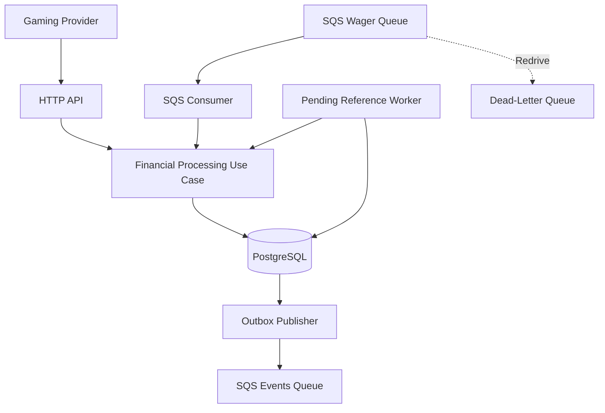
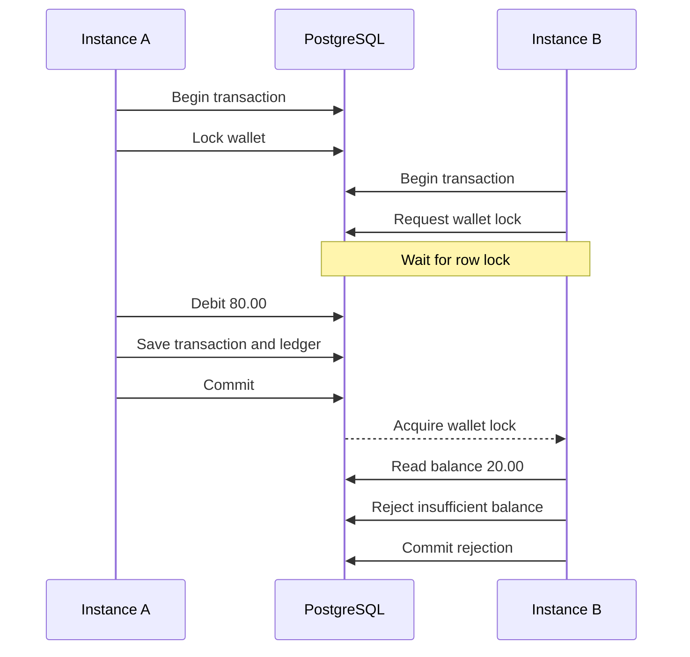
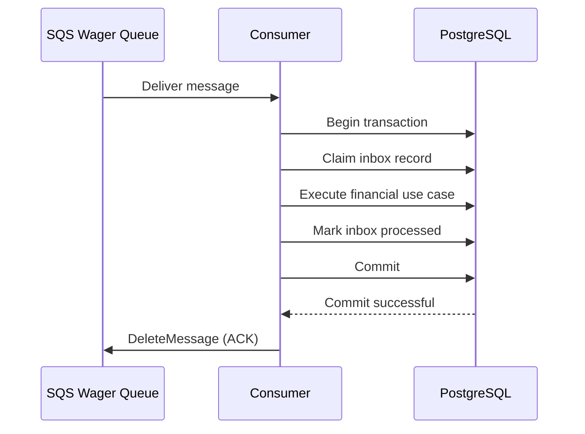
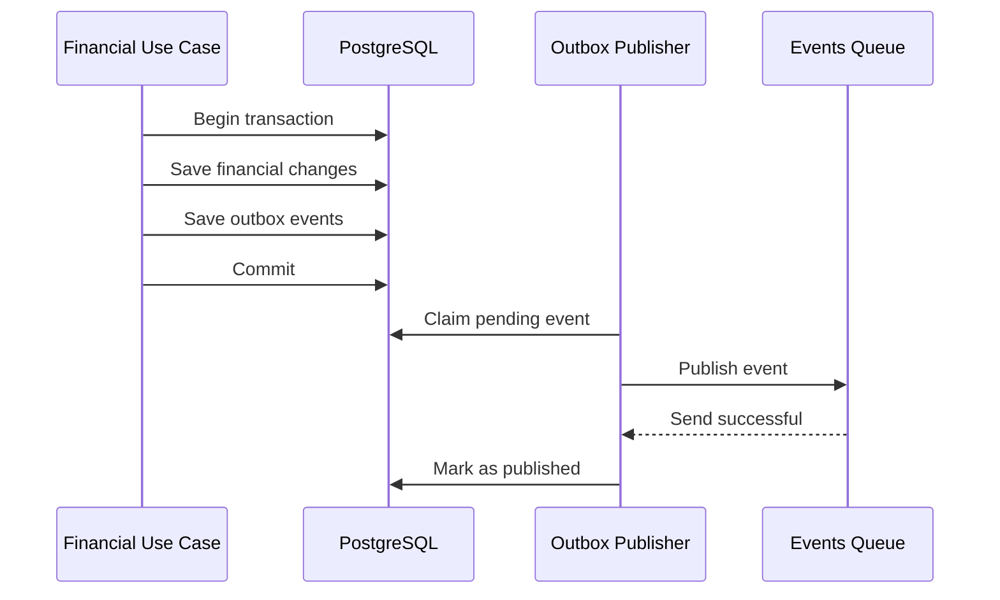

# Architecture and Technical Decisions

## Distributed Wagering Processor — Jungle Gaming

## 1. Overview

The Distributed Wagering Processor is a financial backend service responsible for handling wagering transactions from multiple gaming providers.

Transactions are received through HTTP or SQS, processed using a shared application use case, persisted in PostgreSQL, and followed by asynchronous integration event publishing.

The main design goals are:

- Financial correctness
- Safe concurrent processing
- Persistent idempotency
- Ledger auditability
- Recovery from distributed failures
- Support for multiple application instances

The implementation prioritizes correctness and clear technical decisions over unnecessary architectural complexity.

## 2. Architectural Approach

The application follows a modular architecture organized into four main areas:

### Domain

Contains financial entities, value objects, events, and business rules.

Important components include:

- Money
- Wallet
- WagerTransaction
- WalletLedgerEntry
- InboxMessage
- OutboxMessage

### Application

Coordinates use cases and background operations.

Main components:

- CreateWalletUseCase
- ProcessWagerTransactionUseCase
- GetWagerTransactionUseCase
- GetWalletUseCase
- GetWalletLedgerUseCase
- ReconcileWalletUseCase
- PendingReferenceWorker
- PendingReferenceScheduler

`ProcessWagerTransactionUseCase` is the main financial processing entry point used by HTTP and SQS.

An additional `ProcessWinUseCase` exists in the codebase but is not registered in `AppModule` as part of the main application flow.

### Infrastructure

Contains persistence, messaging, authentication extension points, and observability.

Main components:

- MikroORM repositories
- SqsWagerConsumer
- SqsOutboxPublisher
- MetricsService
- ProviderAuthGuard

### Interfaces

Contains HTTP controllers and request/response handling.

Main components:

- WalletController
- WagerController
- WagerQueryController
- HealthController
- MetricsController
- HttpLoggingInterceptor

### Architectural Diagram



### Why a Modular Monolith?

The challenge requires multiple application instances but does not require independently deployed microservices.

A modular NestJS application was chosen to reduce operational complexity while preserving responsibilities.

The same application contains HTTP endpoints, message consumption, and background workers.

Multiple instances can share the same PostgreSQL database and SQS queues.

The provided Docker Compose configuration runs infrastructure services rather than application replicas.

## 3. Technology Decisions

| Technology | Purpose |
|---|---|
| Bun | Runtime, package management, and testing |
| TypeScript | Strict typing |
| NestJS | Application structure and dependency injection |
| PostgreSQL | ACID transactions and concurrency control |
| MikroORM | Persistence and transaction management |
| decimal.js | Exact decimal arithmetic |
| AWS SQS | Asynchronous message transport |
| MiniStack | Local AWS-compatible testing |
| Docker Compose | Local infrastructure |

### Why MikroORM?

MikroORM was preferred in the challenge specification.

It supports PostgreSQL transactions and controlled persistence access.

The implementation also uses SQL constraints, indexes, and triggers directly, because financial correctness must not depend only on application-level validation.

## 4. Financial Model

### Money

Money is represented by an immutable value object using `decimal.js`.

Financial amounts are handled as decimal strings rather than JavaScript floating-point numbers.

Example:

```json
{
  "amount": "25.00",
  "currency": "BRL"
}
```

The database stores financial values using `NUMERIC(20, 2)`.

The HTTP interface accepts decimal strings with up to two fractional digits. Values are normalized to two decimal places.

Operations involving different currencies are rejected.

### Wallet

The wallet represents the player's balance in one currency.

Its invariants include:

- One wallet per player and currency
- Non-negative balance
- Currency consistency
- Balance updates recorded in the ledger
- Protection from concurrent lost updates

Wallet updates are synchronized using PostgreSQL row-level locks.

### WagerTransaction

Supported operations are:

| Kind | Effect |
|---|---|
| OPENING | Internal initial balance credit |
| BET | Debit |
| WIN | Credit |
| LOSS | No balance change |
| REFUND | Credit reversing a BET |
| ROLLBACK | Inverse movement of a supported reference |

Transaction statuses include:

- PENDING
- PENDING_REFERENCE
- PROCESSED
- REJECTED
- FAILED

Processed, rejected, and failed transactions are terminal.

The same idempotency key and business payload must return the original result.

### Ledger

Ledger entries are immutable financial records containing:

- Wallet ID
- Transaction ID
- Direction
- Amount and currency
- Balance before
- Balance after
- Creation timestamp

Each processed transaction that changes the balance requires one corresponding ledger entry.

LOSS and non-processed transactions must not create ledger movements.

The database enforces ledger arithmetic.

## 5. Financial Consistency

Financial updates are executed inside PostgreSQL transactions.

The financial operation, ledger entry, and outgoing integration events are persisted in the same transaction.

If an operation fails before commit, PostgreSQL rolls back its uncommitted changes.

The database schema contains additional guarantees.

### Database Constraints

The first migration defines:

- Unique wallet by player and currency
- Unique transaction idempotency key
- Unique external transaction identifier per provider
- Non-negative wallet balance
- Valid transaction kinds and statuses
- Positive transaction amounts
- Ledger arithmetic checks
- Unique ledger entry per transaction and wallet
- Inbox identity constraints
- Outbox state constraints

### Deferred Consistency Triggers

The second migration implements deferred financial consistency checks.

At transaction commit, PostgreSQL validates that:

1. The wallet balance equals the sum of its ledger credits minus debits.
2. A processed balance-changing transaction has exactly one ledger entry.
3. LOSS and non-processed transactions have no ledger entry.
4. Ledger direction and amount match the financial operation.
5. Processed reversals have valid references.

The triggers are `DEFERRABLE INITIALLY DEFERRED`, allowing the related records to be written within one transaction before the final consistency checks are evaluated.

### Ledger Immutability

Database triggers prevent:

- UPDATE
- DELETE
- TRUNCATE

This ensures that ledger entries cannot be silently rewritten or removed through ordinary database operations.

## 6. Concurrency Control

### Chosen Strategy

The application uses pessimistic PostgreSQL row-level locking.

Financial processing calls `findByIdForUpdate()` on the affected wallet.

This serializes operations that attempt to modify the same wallet.

It works across independent application instances because the locking is enforced by PostgreSQL rather than in process memory.

### Concurrent BET Example

Initial balance: `100.00 BRL`.

Two concurrent transactions attempt to debit `80.00 BRL`.



The expected result is:

- One PROCESSED BET
- One REJECTED BET
- Final balance `20.00 BRL`
- One debit ledger entry

### Trade-offs

Row-level locking can create contention when many requests target the same wallet.

However, it avoids lost updates and is simpler than introducing a distributed locking service.

SQS FIFO ordering is an optimization, not the final financial consistency guarantee.

## 7. Persistent Idempotency

The application uses persistent PostgreSQL records to recognize repeated operations.

Protection includes:

- Unique idempotency keys
- Provider and external transaction uniqueness
- Canonical payload hashes
- Stored processing results
- Persistent SQS inbox records

### Repeated Requests

An identical request returns the previously stored transaction result, including the original balance.

No second debit, credit, or ledger entry is generated.

### Conflicting Requests

Reusing an idempotency key with a different business payload results in a conflict.

An external transaction identifier already used by the same provider cannot identify a different transaction.

### Why Persistence?

An in-memory cache would not protect against duplicate operations after restart or across multiple application instances.

PostgreSQL provides a shared, persistent source of truth.

## 8. Reversals and Out-of-Order References

REFUND and ROLLBACK require a valid reference transaction.

The application validates:

- Reference status
- Provider
- Player
- Wallet
- Currency
- Round
- Amount
- Supported reference type

REFUND requires a processed BET.

ROLLBACK can reverse a processed BET, WIN, or REFUND.

### Financial Effects

| Operation | Reference | Effect |
|---|---|---|
| REFUND | BET | CREDIT |
| ROLLBACK | BET | CREDIT |
| ROLLBACK | WIN | DEBIT |
| ROLLBACK | REFUND | DEBIT |

If a reversal would produce a negative balance, it is rejected with `INSUFFICIENT_REVERSAL_BALANCE`.

A normal BET with insufficient funds is rejected with `INSUFFICIENT_BALANCE`.

### Duplicate Reversal Protection

The database contains a partial unique index:

`uq_processed_reversal`

It prevents more than one processed REFUND or more than one processed ROLLBACK for the same reference.

Because the index includes transaction kind, it does not independently prevent one REFUND and one ROLLBACK from referencing the same transaction.

This limitation is explicitly acknowledged rather than claiming a stronger guarantee than the schema enforces.

### Missing References

If a reference is missing or not yet ready, the transaction is stored as `PENDING_REFERENCE`.

The pending-reference worker retries resolution.

Retry state is persisted in the database.

When the retry limit is exhausted, the transaction is rejected using:

- `REFERENCE_NOT_FOUND`
- `REFERENCE_NOT_READY`

The scheduler is configured with a one-second polling interval.

Actual retry eligibility is determined by the persisted next-attempt timestamp.

## 9. Persistent Inbox

The inbox implements durable SQS message deduplication.

Inbox records contain:

- Consumer name
- Message identifier
- Payload hash
- Reception timestamp
- Processing timestamp

The database uses a composite primary key consisting of consumer name and message ID.

### Processing Flow



### Failure After Commit, Before ACK

The consumer may successfully commit its financial changes but fail to acknowledge the message.

When SQS delivers the message again, the inbox identifies it as already processed.

The consumer then acknowledges the duplicate without executing the financial operation again.

This behavior was verified using an integration test with controlled acknowledgment failure.

## 10. SQS Consumer

The consumer receives messages from:

`wager-transactions.fifo`

It uses:

- One message per receive request
- Long polling of 10 seconds
- Initial visibility timeout of 60 seconds
- Persistent inbox
- Transactional financial processing
- Acknowledgment after database commit

### Error Handling

The consumer distinguishes permanent errors from transient errors.

Permanent errors include malformed message envelopes and certain persistent identity or payload conflicts.

Transient errors remain eligible for redelivery.

### Retry Strategy

For transient failures, the consumer changes SQS message visibility using exponential backoff.

The delay starts at 5 seconds and is capped at 60 seconds.

The queue's redrive policy uses `maxReceiveCount = 5`.

Messages that repeatedly fail can be moved to:

`wager-transactions-dlq.fifo`

### Graceful Shutdown

The consumer implements NestJS module lifecycle hooks.

During shutdown, it:

1. Stops receiving new messages.
2. Aborts an active long-poll request.
3. Waits for the current processing cycle to complete.

The application enables shutdown hooks for `SIGINT` and `SIGTERM`.

The controlled integration test validates the consumer's shutdown behavior.

A real Linux operating-system crash during active processing was not independently demonstrated.

## 11. Transactional Outbox

The outbox ensures that integration events are persisted in the same transaction as the associated financial changes.

The publisher runs asynchronously after commit.

Outgoing events are sent to:

`wager-events.fifo`

### Event Types

- `WagerTransactionProcessed`
- `WagerTransactionRejected`
- `WagerTransactionPendingReference`
- `WalletBalanceChanged`

The last event is generated only when a wallet balance actually changes.

### Publishing Flow



### Concurrent Publishing

Outbox messages use persistent claim tokens.

The publisher claims one pending message per polling cycle.

After publication, the message is marked as published only if the claim token is still valid.

Expired claims can be recovered by another publisher.

### SQS FIFO Configuration

The publisher uses:

- `MessageGroupId`: aggregate ID
- `MessageDeduplicationId`: event ID

These identifiers help preserve ordering within a group and reduce duplicate delivery.

They do not replace downstream persistent idempotency.

### Retry Strategy

Failed publishing attempts use exponential backoff capped at 300 seconds.

Retry attempts and next-attempt timestamps are persisted.

### Delivery Guarantee

The outbox provides at-least-once publication.

If SQS accepts an event but the publisher fails before updating PostgreSQL, the event may be sent again.

Downstream consumers must handle duplicate event IDs safely.

Exactly-once delivery is not claimed.

## 12. Database Migrations

The project contains two migrations:

### Migration202610290001

Creates the main tables, constraints, indexes, and relationships.

Main tables:

- wallets
- wager_transactions
- wallet_ledger_entries
- inbox_messages
- outbox_messages

### Migration202610290002

Adds:

- Ledger immutability triggers
- Ledger truncation protection
- Deferred wallet and ledger consistency validation
- Processed transaction financial checks
- Reference validation for processed reversals

Both migrations define rollback operations.

Migration application and reversal were tested using a separate PostgreSQL database.

## 13. Observability

### Structured Logging

HTTP, consumer, and publisher operations generate JSON logs.

Identifiers such as correlation ID, wallet ID, transaction ID, message ID, and event ID are included when available.

### Health Endpoints

- `GET /health/live`
- `GET /health/ready`

Readiness checks PostgreSQL and SQS connectivity.

### Metrics Endpoint

`GET /metrics`

Available metrics include:

- HTTP request counts
- HTTP response status counts
- Financial transaction status counts
- Duplicate transaction count
- SQS retry count
- Lock conflict count
- Outbox publication count
- Outbox retry count
- Processing duration
- Outbox publishing lag
- DLQ message estimates

Metrics are maintained per application instance and are not centrally aggregated.

Lock conflict counters record recognized database conflict errors, not every period spent waiting for a row lock.

## 14. Authentication Decision

Authentication was intentionally excluded from this delivery.

The challenge explicitly accepts this decision and assigns no points to authentication.

The implementation prioritizes financial consistency, concurrency, persistent idempotency, and failure recovery.

### Current Extension Point

The application registers `ProviderAuthGuard` globally through NestJS `APP_GUARD`.

The current implementation is a no-op and allows requests without validating credentials.

It is not a functional authentication mechanism.

### Proposed Production Design

A future production implementation could integrate an external Identity Provider such as Keycloak or Zitadel.

The proposed approach would use OIDC/OAuth 2.0:

1. Validate access tokens at the HTTP boundary.
2. Identify the authenticated provider.
3. Check authorization for the requested operation.
4. Pass the validated provider identity to the application layer.
5. Keep domain logic independent of authentication infrastructure.

Health endpoints would remain publicly accessible.

SQS messages are treated as an internal trusted transport, while provider identifiers remain subject to domain validation.

## 15. Testing Strategy

The project uses Bun Test.

### Unit Tests

Unit tests verify domain behavior, value objects, event construction, application utilities, and selected interface logic.

Some unit tests remain next to implementation files under `src/`.

Others are organized under `test/unit/`.

### Integration Tests

Integration tests use PostgreSQL and MiniStack to validate persistence and messaging behavior.

They cover:

- Wallet creation and persistence
- Financial transactions
- Atomicity
- Idempotency
- Concurrency
- Ledger retrieval
- Reconciliation
- Inbox processing
- Outbox persistence
- Pending references
- SQS delivery, retries, and DLQ
- Failure after commit but before ACK
- Graceful consumer shutdown

A concurrent financial scenario involving two BET requests of `80.00 BRL` against an initial balance of `100.00 BRL` was exercised during development.

The expected final balance is `20.00 BRL`, with one successful debit.

The SQS resilience tests use controlled failure injection.

They do not demonstrate every possible infrastructure failure or a real Linux process crash during active processing.

## 16. Trade-offs and Limitations

### Modular Monolith

The application combines HTTP, SQS consumption, and background workers.

This reduces operational complexity but shares one deployment lifecycle.

### Pessimistic Locking

PostgreSQL row-level locks prevent lost updates.

The trade-off is increased contention when many operations target the same wallet.

### Transactional Inbox and Outbox

Persistent inbox and outbox records improve recoverability and idempotency.

The trade-off is additional database storage and processing.

### Eventual Event Delivery

Outbox publication happens after commit.

The trade-off is that events can be delayed or delivered more than once.

### Pending References

Missing references remain pending and are retried asynchronously.

The trade-off is increased processing latency and additional transaction states.

### Multiple Instances

The design supports several instances sharing PostgreSQL and SQS.

The provided Docker Compose configuration does not deploy or load-balance application replicas.

### Authentication

The existing guard is an extension point only.

HTTP authentication and authorization are not enforced.

### Observability

Metrics are instance-local and in-memory.

Centralized monitoring, persistent metrics, and distributed tracing are not included.

### Reversal Uniqueness

The database prevents repeated processed reversals of the same kind for the same reference.

It does not independently prohibit a processed REFUND and a processed ROLLBACK from targeting the same reference.

### Local Infrastructure

MiniStack emulates AWS SQS for local development and testing.

Production AWS behavior and every possible infrastructure failure were not exhaustively validated.

## 17. Future Improvements

Potential improvements include:

- External Identity Provider integration
- Centralized monitoring
- Distributed tracing
- Automated deployment of application replicas
- Load balancing
- Additional infrastructure fault-injection tests
- Stronger cross-kind reversal restrictions if required by business policy
- Consistent organization of unit and integration test files

These items are future improvements and are not presented as implemented features.

## 18. Final Considerations

The architecture prioritizes financial correctness and recoverability.

Its main guarantees are based on PostgreSQL transactions, row-level locks, persistent idempotency, database constraints, immutable ledger entries, and transactional inbox/outbox processing.

AWS SQS is treated as an at-least-once transport rather than the only source of ordering or consistency.

The implementation supports multiple application instances and addresses duplicate, concurrent, and out-of-order transactions while documenting the limits of the delivered solution.
